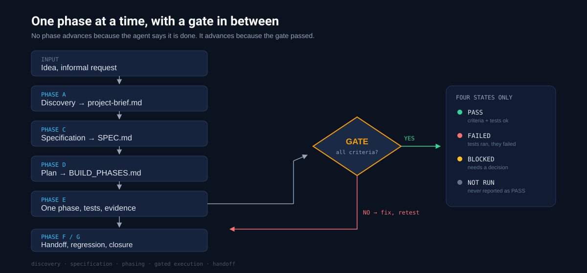

# Phased Build Orchestrator

[](LICENSE)
[](SKILL.md)
[](#compatibility)
[](CHANGELOG.md)



> **An agent skill that turns "build me this" into a sequence of verified phases** — discovery, specification, build phases, a gate between each one, and a handoff that survives a new session.

Most agents can write code. What they cannot do reliably is stop: stop before the spec exists, stop at the end of a phase, stop claiming success without running anything.

This skill is the stop button, written down.

---

## Why this exists

| What usually happens | What it costs |
|---|---|
| Code starts in the first message | a product nobody specified |
| "Done" declared without running tests | a broken branch and a false claim |
| A test that could not run is reported as passing | the exact failure nobody catches later |
| Ten things changed at once | a regression with no suspect |
| Same project across sessions | the next session redoes the discovery from scratch |
| Progress measured by files written | no idea whether the thing works |

Phased Build Orchestrator does not add capability. It removes the failure modes that make an agent's output untrustworthy.

---

## The gate vocabulary

Four states, and only four. This is the core of the skill: a test that could not be executed is `NOT RUN`, **never** `PASS`.

| State | Meaning |
|---|---|
| **`PASS`** | acceptance criteria verified, mandatory tests passed, no known critical regression, state and docs updated |
| **`FAILED`** | tests ran and failed |
| **`BLOCKED`** | progress requires a decision, an access, or an external dependency |
| **`NOT RUN`** | the check could not be executed — a limit to declare, not a success to claim |

An agent that only knows `done` and `not done` will lie to you eventually. Not out of malice: because `not done` has no room for "I couldn't check".

---

## Phase 0 — read the state before anything

Three commands (`ls -a`, `git status --short`, presence of `PRODUCT.md` / `docs/SPEC.md` / `docs/BUILD_PHASES.md` / `docs/HANDOFF.md`), then one declared state with its evidence:

| State | Where it resumes |
|---|---|
| *empty* | phase A |
| *idea* — a `PRODUCT.md`, no code | A, then C |
| *scaffold* — builds, no SPEC | C |
| *in progress* — SPEC and phases exist, not all `PASS` | E, from the first open item in `HANDOFF.md` |
| *broken* — does not build, no git | `groundwork` path C first |

If `docs/HANDOFF.md` exists it is read **before** anything else. The skill asks the user only when the evidence contradicts itself — never when a command can answer.

---

## The seven phases

| Phase | Produces | Loaded from |
|---|---|---|
| **A — Discovery** | `docs/project-brief.md` — objective, context, confirmed requirements, assumptions, open questions, definition of done | `references/discovery.md` |
| **B — Wayfinding** *(only when needed)* | a **decision map** (question, impact, options, choice) — not a task list | `references/discovery.md` |
| **C — Specification** | `docs/SPEC.md` — numbered `FR`/`NFR`, out of scope, architecture, data, errors, acceptance criteria | `references/spec.md` |
| **D — Planning** | `docs/BUILD_PHASES.md` with the mandatory `BP-00X` schema | `references/build-phases.md` |
| **E — Execution** | one phase only: baseline tests → minimal change → verification → gate | `references/execution.md` |
| **F — Handoff** | `docs/PROJECT_STATE.md` + `docs/HANDOFF.md` | `references/handoff.md` |
| **G — Closure** | regression run, SPEC comparison, documentation, declared limits | `references/closure.md` |

Plus `references/integrations.md` (third-party skills, with verified paths) and `references/prompts.md` (ready-to-paste prompts).

---

## Install

A skill is a directory. Copy it where your agent looks for skills.

| Host | Path | Notes |
|---|---|---|
| **Hermes** | `<hermes-home>/skills/phased-build-orchestrator` | or install from the registry, below |
| **Claude Code** | `~/.claude/skills/phased-build-orchestrator` | native `SKILL.md` support |
| **Codex** | `~/.codex/skills/phased-build-orchestrator` | reads `SKILL.md` with frontmatter |
| **OpenCode** | `~/.config/opencode/skills/phased-build-orchestrator` | same format |
| **Codebuff / Freebuff** | `~/.agents/skills/phased-build-orchestrator` | also reads `~/.claude/skills`; `.agents/` wins |

### One-liner per host

| Host | Command |
|---|---|
| **Hermes** | `hermes skills install nemesis1978/phased-build-orchestrator` |
| **Claude Code** | `git clone https://github.com/nemesis1978/phased-build-orchestrator.git ~/.claude/skills/phased-build-orchestrator` |
| **Codex** | `git clone https://github.com/nemesis1978/phased-build-orchestrator.git ~/.codex/skills/phased-build-orchestrator` |
| **OpenCode** | `git clone https://github.com/nemesis1978/phased-build-orchestrator.git ~/.config/opencode/skills/phased-build-orchestrator` |
| **Codebuff / Freebuff** | `git clone https://github.com/nemesis1978/phased-build-orchestrator.git ~/.agents/skills/phased-build-orchestrator` |
| **skills.sh CLI** | `npx skills add nemesis1978/phased-build-orchestrator` |

### Let an agent install it for you

```text
Install the "phased-build-orchestrator" skill from
https://github.com/nemesis1978/phased-build-orchestrator into the skills
directory your runtime reads (~/.claude/skills, ~/.agents/skills,
~/.codex/skills, or ~/.config/opencode/skills), as a folder named
"phased-build-orchestrator". Verify that SKILL.md is readable, that its
frontmatter name matches the folder, and that the eight files in references/
are present. Report the resolved absolute path and the checksum of SKILL.md.
Do not modify any other skill or config.
```

---

## How it is used

**You say:**

> "I want to build a small tool that tracks supplier orders. Use phased build."

**What happens:**

1. It asks only the questions whose answers change the project, and writes `docs/project-brief.md` — marking assumptions as assumptions.
2. It writes `docs/SPEC.md` with numbered requirements and acceptance criteria you can observe from outside.
3. It proposes `docs/BUILD_PHASES.md` — small vertical increments, each with its own mandatory tests.
4. **It stops and waits for your approval of the plan.**
5. It executes one phase: baseline tests first, minimal change, verification, gate.
6. If the gate is not `PASS`, it does not move forward — it fixes, retests, or asks.
7. Before the session ends it writes `docs/HANDOFF.md`, so the next agent resumes instead of restarting.

**What it refuses:**

- Writing code before the spec is approved.
- Reporting `PASS` for a test it could not run.
- Advancing to the next phase because "it looks fine".
- Committing, pushing or deploying without authorization.
- Inventing a commit, a link, a test result, or a tool that is not installed.

---

## What's inside

```
SKILL.md              principles, flow, phases, gate rules, checkpoint format (130 lines)
references/           eight files, loaded only when the phase needs them
scripts/              validate-skill.sh — the executable format contract
assets/               the diagram above
```

`SKILL.md` stays under 200 lines by design: everything an agent must always know is there, everything else is one hop away.

---

## Language

The skill instructions are written in **Italian**. Commands, file names, schemas, and the `description` that triggers the skill work in any language, but an Italian-speaking agent gets the most out of it.

An English translation of `SKILL.md` and the references is a mechanical pass over the same files. It is not included yet because the primary user works in Italian, and a partial translation is worse than an honest note. PRs are welcome — keep code blocks, paths, and phase names identical.

---

## Compatibility

Any host that reads a `SKILL.md` with `name` and `description` frontmatter can use this. Constraints:

- `name` lowercase, hyphenated, **identical to the directory name**;
- `description` short — it is what the host matches against your request;
- supporting files in `references/`, referenced with relative paths.

Tested by copying the same directory to five hosts and checking checksums, not by writing five ports.

## Relation to other skills

| If you have | Use it for | This skill |
|---|---|---|
| `handoff` | the handoff document format | defines only the minimum content |
| `wayfinder` | orienting in an unknown codebase | Phase B is about **decisions**, not code maps |
| `plan` | a short plan for a single task | plans are phased and gated here |
| `groundwork` | machine setup, bootstrap, repair | executes the development work |
| `egix-engineering` | debugging protocol, minimal diffs | invokes it, does not replace it |

---

## Contributing

Corrections and translations are welcome as pull requests. Changes to the principles, the phases, or the gate vocabulary need an issue first — see [CONTRIBUTING.md](CONTRIBUTING.md).

Every pull request must pass:

```bash
bash scripts/validate-skill.sh
```

## Attribution

The method is inspired by the engineering skills published by [Matt Pocock](https://github.com/mattpocock/skills) (`wayfinder`, `to-spec`, `to-tickets`, `tdd`, `handoff`). This repository is an **original re-elaboration**, not a copy and not an official Matt Pocock skill: the text, structure, templates, and validator are original work. Third-party skill names and paths can change — verify before relying on them.

## License

[MIT](LICENSE) © 2026 Egix.
